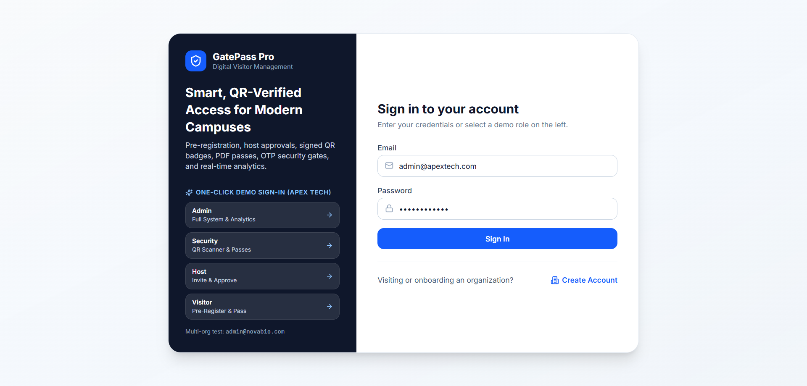
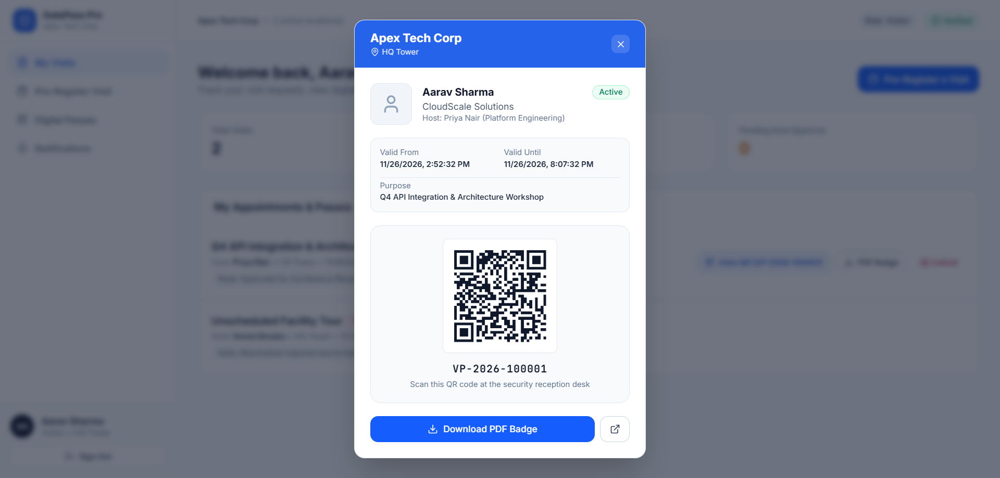
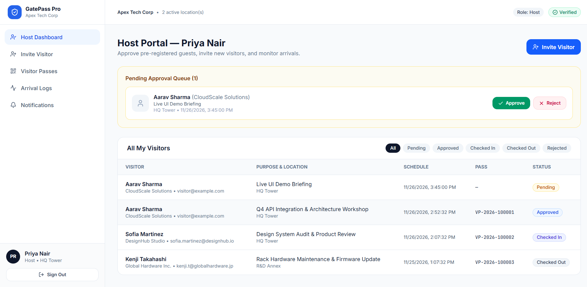
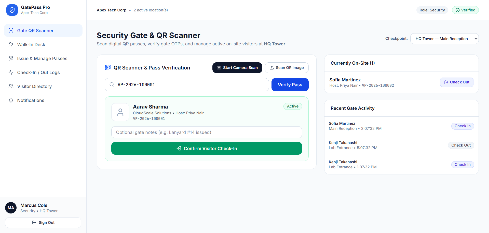
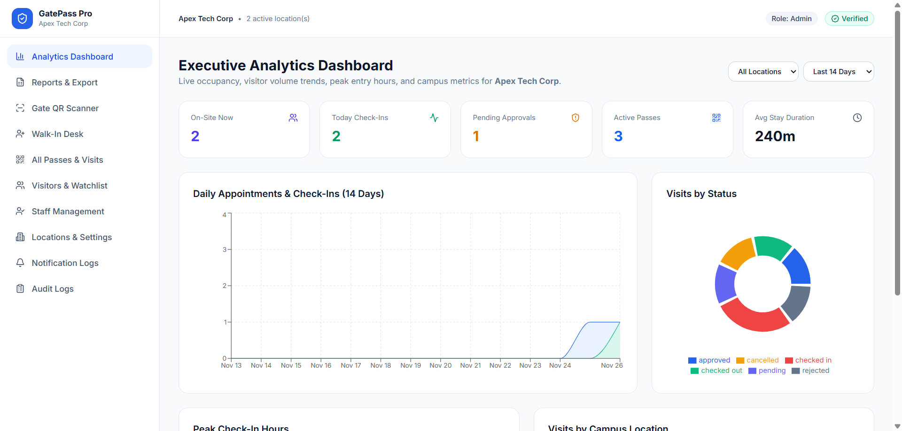
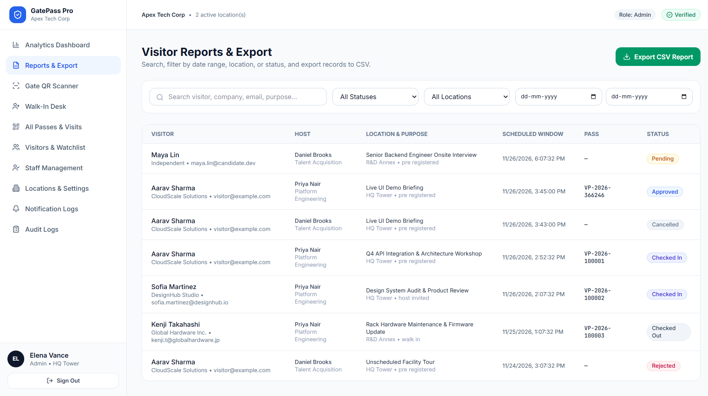

# GatePass Pro — Visitor Pass Management System (MERN)

A full-stack **Visitor Pass Management System** built with the **MERN stack** (MongoDB, Express, React, Node.js). It digitizes manual visitor entry registers with role-based workflows, webcam/file photo registration, host invitations & approvals, HMAC-signed QR passes, printable PDF badges, live QR scanning for check-in/check-out, OTP verification, Email/SMS notifications, multi-organization/multi-location support, analytics, CSV report export, and audit logging.

---

## Key Features & Role Matrix

| Role | Capabilities |
| :--- | :--- |
| **Admin** | Executive analytics dashboard, CSV reports, staff provisioning, multi-location & gate configuration, organization security policies, audit logs, and full pass/visitor oversight. |
| **Security / Frontdesk** | Live camera/image/manual QR pass scanner, Gate OTP verification, walk-in visitor desk with instant photo & QR pass issuance, active on-site board, check-out, pass revocation, and watchlist flagging. |
| **Employee / Host** | Invite visitors (auto-approved), approve/reject pre-registration requests, view expected arrivals & check-in logs. |
| **Visitor** | Self-registration with OTP verification, pre-register visits with photo capture, track approval status, view live digital QR pass, and download printable PDF badge. |

### Bonus Features Implemented
- **OTP Verification**: 6-digit account verification OTP and optional per-organization / per-visit **Gate OTP** enforcement at check-in.
- **Multi-Organization & Multi-Location Support**: Strict organization tenant isolation plus multiple campus locations and named security checkpoints/gates per organization.
- **Immutable Audit Logs**: Tracks logins, OTP verifications, staff changes, appointment approvals, pass issuances/revocations, and gate scans.
- **Analytics Dashboard**: Interactive KPIs, daily appointment/check-in trends, status distribution, peak arrival hours, and campus breakdown via Recharts.
- **Docker + Nginx Deployment**: Multi-container setup routing `/api` and `/uploads` to Express and `/` to the Vite React production bundle.

---

## Project Architecture

```text
.
├── client/                 # React 18 + Vite + Tailwind CSS v4 + Recharts + html5-qrcode
│   ├── src/
│   │   ├── api/            # Axios client & JWT interceptor
│   │   ├── components/     # Layout, PassCardModal, WebcamCapture, StatusBadge
│   │   ├── context/        # AuthContext
│   │   └── pages/          # Auth, Visitor, Host, Security, Admin, and Shared views
│   └── Dockerfile
├── server/                 # Node.js + Express + Mongoose + PDFKit + QRCode + Multer
│   ├── src/
│   │   ├── config/         # Env validation & MongoDB connector (Atlas/local + memory fallback)
│   │   ├── middleware/     # JWT auth, RBAC guards, Multer image upload
│   │   ├── models/         # Users, Visitors, Appointments, Passes, CheckLogs, Organizations, AuditLogs, Notifications
│   │   ├── routes/         # Modular REST endpoints
│   │   ├── services/       # QR signing, PDF badge generator, OTP, Email/SMS notifications, Audit logger
│   │   └── scripts/        # Demo seed script (seed.js)
│   ├── tests/              # Integration tests (node --test + supertest)
│   └── Dockerfile
├── nginx/nginx.conf        # Reverse proxy configuration
├── docker-compose.yml      # MongoDB + API + Web + Nginx stack
└── .env.example            # Environment variable template
```

---

## Local Setup & Quick Start

### Prerequisites
- **Node.js** >= 20
- **MongoDB** (Atlas URI or local `mongod`; if unreachable in development, the API automatically falls back to an auto-seeded `mongodb-memory-server` instance)

### 1. Install Dependencies
```bash
npm run install:all
npm install
```

### 2. Configure Environment
Copy `.env.example` to `.env` in the workspace root:
```bash
cp .env.example .env
```
Update `MONGODB_URI` with your MongoDB Atlas or local connection string. If using Atlas, ensure your IP address is added under **MongoDB Atlas → Network Access**.

*(SMTP and Twilio credentials are optional. When omitted, all Email and SMS notifications are persisted cleanly in the `notifications` collection and visible in the in-app Notification Log.)*

### 3. Seed Demo Data
```bash
npm run seed
```

### 4. Start Development Servers
```bash
npm run dev
```
- **Frontend**: `http://localhost:5173`
- **Backend API**: `http://localhost:5000` (`GET /api/health`)

---

## Seeded Demo Credentials

All seeded demo accounts use password: **`Password@123`**

| Organization | Role | Email |
| :--- | :--- | :--- |
| **Apex Tech Corp** | Admin | `admin@apextech.com` |
| **Apex Tech Corp** | Security / Frontdesk | `security@apextech.com` |
| **Apex Tech Corp** | Employee / Host | `host@apextech.com` |
| **Apex Tech Corp** | Employee / Host (HR) | `host2@apextech.com` |
| **Apex Tech Corp** | Visitor | `visitor@example.com` |
| **NovaBio Labs** | Admin (Multi-Org Isolation) | `admin@novabio.com` |

---

## Running Tests & Production Build

```bash
# Run full backend integration test suite (13 tests across 4 suites)
npm test

# Build frontend production bundle
npm run build
```

---

## Docker + Nginx Production Deployment

1. Set strong secrets in `.env` (or shell environment):
   ```bash
   export JWT_SECRET="your_strong_jwt_secret"
   export QR_SIGNING_SECRET="your_strong_qr_secret"
   ```
2. Build and start all services:
   ```bash
   docker compose up --build -d
   ```
3. Seed the containerized MongoDB instance (optional):
   ```bash
   docker compose exec api node src/scripts/seed.js
   ```
4. Open `http://localhost` in your browser.

---

## Cloud Deployment (Render + Vercel)

1. **Allow Cloud DB Access in MongoDB Atlas**: In **MongoDB Atlas → Security → Network Access**, add `0.0.0.0/0` (or your cloud provider's outbound IPs) so your hosted backend can connect.
2. **Deploy Backend (`server/`) on Render** *(using included [render.yaml](render.yaml))*:
   - Root Directory: `server` | Build Command: `npm ci --omit=dev` | Start Command: `node src/server.js`
   - Environment variables: `NODE_ENV=production`, `MONGODB_URI=<your-atlas-uri>`, `JWT_SECRET=<secret>`, `QR_SIGNING_SECRET=<secret>`, `CLIENT_URL=https://<your-vercel-domain>.vercel.app`, `ALLOW_MEMORY_DB_FALLBACK=false`
3. **Deploy Frontend (`client/`) on Vercel** *(using included [client/vercel.json](client/vercel.json))*:
   - Root Directory: `client` | Framework Preset: `Vite` | Build Command: `npm run build` | Output Directory: `dist`
   - Environment variable: `VITE_API_BASE_URL=https://<your-render-service>.onrender.com`

---

## Core API Endpoints

- `GET /api/health` — API and MongoDB connection status & document counts
- `POST /api/auth/register` | `POST /api/auth/login` | `GET /api/auth/me`
- `POST /api/auth/send-otp` | `POST /api/auth/verify-otp`
- `GET /api/organizations/public` | `GET/PATCH /api/organizations/current` | `POST /api/organizations/current/locations`
- `GET /api/users/hosts` | `GET/POST/PATCH /api/users`
- `GET/POST/PATCH /api/visitors` (supports multipart photo upload & base64 webcam capture)
- `POST /api/appointments/pre-register` | `POST /api/appointments/invite` | `GET /api/appointments` | `PATCH /api/appointments/:id/status`
- `POST /api/passes/issue` | `POST /api/passes/walk-in` | `GET /api/passes` | `GET /api/passes/:id/pdf` | `PATCH /api/passes/:id/revoke`
- `POST /api/checklogs/verify` | `POST /api/checklogs/scan` | `GET /api/checklogs`
- `GET /api/reports/analytics` | `GET /api/reports/export` (CSV)
- `GET /api/notifications` | `GET /api/audit-logs`

---

## Screenshots

### Login & One-Click Role Switcher


### Visitor Digital QR Pass & PDF Badge Modal


### Employee / Host Approval Queue


### Security Gate QR Scanner & On-Site Board


### Admin Analytics Dashboard


### Visitor Reports & CSV Export


